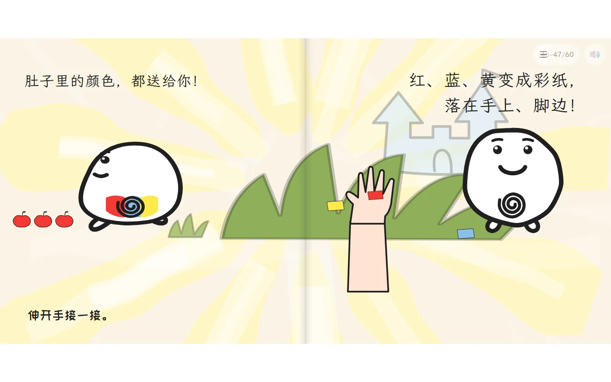

<h1> 啊呜噜啵！绘本系列</h1>

> 给 3–5 岁孩子的中文互动绘本，五册：喂它就变色，它生病、闹脾气、非要自己来。无需注册，不上传数据。

[](LICENSE) [](LICENSE-CONTENT.md) [](https://github.com/rockbenben/365opensource)

[⬇ 自己跑一份](#自己跑一份)（`npm ci && npm run build`） · [🖨 打印版（64 页）](#打印) · [📖 支持哪些设备](#支持范围)


大人读，孩子跟着喂、揉、找：噜啵吃下苹果、小鱼和星星，肚子里装满颜色；它会躲进草丛，翘起两只小脚回答「我在这儿！」，最后把颜色送给你。

现在有**五册**，每一册都把孩子的位置翻过来一次：

| 册 | 孩子扮演什么 | 一句话 |
|---|---|---|
| 《啊呜噜啵！》 | 照顾者 | 你喂它苹果、小鱼、黄星星，它就变成那个颜色；三样一起吃会变彩虹。 |
| 《噜啵生病啦！》 | 照顾者 | 它病了，你陪着它、盖好毯子；它愿意喝水后才递杯，药物由大人负责。 |
| 《一起玩！》 | 玩伴 | 球只有一个，从护球和争抢，到它主动把球传给你。 |
| 《生气啦！》 | 一起生气 | 你和它一起生气，慢慢呼气，红色还留着；半座塔没搭完，你们约好明天再搭。 |
| 《我自己来！》 | 被拒绝的大人 | 它坚持自己收，后来让你接手；你也说「我自己来」，它听见后收脚退开。 |

## 支持范围

| 方面 | 说明 |
|---|---|
| **屏幕** | 已通过 Chromium 自动验收；iPad / Safari、Firefox 等浏览器尚待实机验证。手机与平板建议通过 HTTP(S) 打开，兼容性以实际设备测试为准。 |
| **打印** | 成品 210 × 210 mm（PDF 216 × 216 mm 含 3 mm 出血），骑马钉；A4 双面拼版对折即成，另有 A3 版。页数是 4 的倍数，排得开帖。 |
| **离线** | HTML 自包含，文字、字体、声音与互动不请求外部资源。通过网站访问时，首次加载仍需连接该站点；尚未验证断网后刷新或重新打开。 |
| **构成** | 文字、声音、互动、字体全在一个 HTML 文件里，不依赖位图插画——改一句话就能重印一版。 |
| **字体** | 内嵌子集，可商用（OFL 1.1），详见 [LICENSES.md](LICENSES.md)。 |
| **授权** | 代码是 MIT，随便拿去用；**噜啵和这五册书不是**——可免费读、打印、分享，不可商用、不可改编，详见 [LICENSE-CONTENT.md](LICENSE-CONTENT.md)。 |
| **参考书** | 只用于画风分析，不随项目分发；角色、咒语、桥段、构图全部原创。 |

## 能做什么

- **喂它**：喂红苹果、蓝小鱼、黄星星，它就变成那个颜色；三样一起吃会变彩虹。
- **揉它**：揉肚子、转圈，打嗝会把彩纸喷满整页。
- **找它**：跟它躲猫猫、数一数有几个苹果，它会从草丛里翘起两只脚回答，然后主动蹦近。
- **一起玩**：拍手、转圈、跺脚，孩子动起来，大人也跟着动。
- **争一场**：第三册里球只有一个，它不让——得先拉锯、谁先开口，才轮得到一起玩。
- **一起深呼吸**：第四册里它和你一起生气；慢慢呼一口气，嘴只松一点，红色还在，之后自己约定明天。
- **收进篮子**：第五册里它先自己收苹果，再让孩子收小鱼和最后的星星；听见“等一等”，它会收脚退开。
- **入夜**：球与发带、半座塔和领巾、同三物的侧躺篮都留在原处，慢慢安静下来，不追加睡前任务。
- **只看也可以**：没有动作提示的页面可以直接翻阅，共读模拟也可以跳过，不用每页都点一下。
- **读给孩子听**：每一册 64 页、28 个跨页，每页只做一件事；旁白念给孩子，拟声词让孩子跟着说。

五册已按冻结 R7 完成整册制作及自动验收。五册区分观察、共读模拟与角色自主动作，可以只看、听或模拟；指认不吃掉物件，自主动作不新增点击任务。第二册尊重拒水，自主张嘴后才递杯，药物由成人负责；第三册从争抢到自愿回传，数三下不强制分享；第四册同一顶块先放偏、捡回再放正，主动约定明天；第五册同三物逐件收进固定侧躺篮，角色抬脚未碰星，听到停后退开。背景以纯色和大色带为主，少量加入儿童幻想线索。人工试读、五册合读和实体打样尚未完成。

画面以纯色、大色带和夸张笔触为主，少量纸片城堡、软圆光口与色岛构成幻想空间，角色及动作保持第一视觉重点。

## 怎么用

给孩子读：**指着画里的东西念出来**——「苹果！」「小鱼！」「星星！」。大人读旁白，孩子跟着念拟声词（啊呜、嗝、呼噜、咕噜），按提示喂它、揉肚子或找一找。屏幕版通过点按、画圈等操作给出声音与动作反馈，不识别语音，也不需要麦克风。

翻页：点书页空白处，或左右滑动，或用方向键。**不必按顺序读**——右上角的页码按钮能直接跳到任何一页，想找「数一数」那页不用从头翻。

屏幕够宽时是**摊开的两页**，像真的翻开一本书：左右两页并排，翻一次翻一跨（和纸书的骑马钉装订一样）。屏幕窄了就回到一页一屏——手机上两页挤在一起字太小。

阅读器按浏览器可用宽度自动切换：小于 1100 CSS 像素时单页显示，达到 1100 时显示双页跨页。iPad 旋转或分屏后也按当前可用宽度判断，不固定为单页；首次触摸可解锁声音，右上角可以静音。

右上角的 ☰ 按钮里有三件事：**选一册**、**看它的方式**（网页 / 打印版 / 骑马钉拼版），还有一段**给大人的话**——屏幕版跳过纸书的 p61，每册最要紧的共读提示放在这里。

大人读：**旁白念给孩子听，拟声词让孩子跟着说**。点错了不用说「不对」，再来一次就好。屏幕版一次别读太久，小小孩优先一起翻纸书。

5–6 岁可以换个位置当领读者：让孩子念拟声词、给弟弟妹妹指画面上的东西，书稿不用改。

## 看看长什么样

屏幕够宽时摊开成两页，像真的翻开一本书——左边是刚读过的那页，右边是还没读的那页：



| 找一找 | 数一数 |
| --- | --- |
|  |  |

| 主动靠近 | 送给你的颜色 | 生气啦 |
| --- | --- | --- |
|  |  |  |

<sub>截图由 `npm run shots:readme` 从当前构建生成。</sub>

## 限制

- **界面全中文**：没有英文版。纸书版也没有声音——声音是屏幕版用 Web Audio 现场合成的。
- **还没有在线试玩**：这一版还没发布到网上。克隆下来跑一次就能看（`npm ci && npm run build`，然后双击 `dist/index.html`）——绘本是一个单文件，拷到哪台电脑都能开。
- **iPad / Safari 尚待实机验证**：手机与平板建议通过 HTTP(S) 打开；本地文件预览、触摸、声音及横竖屏表现不能用桌面模拟结果代替。
- **还没有实物打样**：PDF 已通过页数、纸型、字体嵌入等自动检查，但还没在纸上印过一遍。
- **尚未做儿童试读**：自动化检查不能代替真实共读体验。

## 给开发者

### 自己跑一份

需要 Node.js 24 或更新版本。安装依赖后构建：

```bash
npm ci
npm run build
npm run preview
```

电脑可直接打开 `dist/index.html`；手机与平板请通过本地 HTTP 服务或部署站点访问。开发时使用 `npm run dev`。

改正文后先运行 `npm run fonts`，再构建。字体子集及其戳记需要提交。导出 PDF 与运行完整验收还需要 Python 依赖和 Playwright Chromium，安装步骤及完整命令见[贡献指南](CONTRIBUTING.md)。

### 常用命令

| 命令 | 用途 |
|---|---|
| `npm run build` / `npm run site` | 构建四个单文件入口，整理五文件公开目录 |
| `npm run check` | 类型、书稿、内容、色系、热区、版式、授权、字体检查 |
| `npm run verify:reader` / `npm run smoke` | 阅读器代表场景与五册互动通扫 |
| `npm run chaos` | 单页与跨页乱读压力测试 |
| `npm run shots` / `npm run shots:print` | 按册截图屏幕版与印刷版 |
| `npm run check:shots` / `npm run check:contrast` | 截图完整性与实际文字对比度 |
| `npm run check:repeat` / `node tools/audit-script.mjs` | 跨页及同页重复文案检查，两道都要跑 |
| `npm run verify:teeth` | 在一次性副本中执行破坏测试 |
| `npm run pdf` / `npm run pdf:booklet` | 单页 PDF 与骑马钉拼版；拼版加 `-- --a3` 导出 A3 |
| `npm run shots:readme` / `npm run brand` | 更新 README 截图、logo 与社交预览图 |
| `npm run check:publish` | 远端、联系方式、公开文件清单与预览图检查 |

### 项目结构

- `src/content/books/`：五册书稿；`index.js` 是册清单，加一册只需新建目录并登记。
- `src/components/`、`src/css/`、`src/templates/`：角色与道具 SVG、样式和页面骨架。
- `src/js/`：阅读状态机、动作生命周期、音效及浮层。纸屏共用 `model.ts` 的装订配对规则，动作通过 `BookEffects` 报告完成。
- `src/fonts/`：随仓库提交的授权字体子集。
- `tools/`：构建、验收、截图与 PDF 导出。
- `deploy/`：部署配置与操作说明。

修改书稿前先读[设计规格](docs/superpowers/specs/2026-10-30-awulubo-picture-book-design.md)；协作约定见 [AGENTS.md](AGENTS.md)。历轮设计与审查过程保存在[样张记录归档](docs/archive/M0-样张记录.md)，其中旧接口与待办不代表当前状态。

## 打印

每册三份 PDF，用途不同：

| 文件 | 纸张 | 用途 |
|---|---|---|
| `dist-print/<册>.pdf`（`awulubo.pdf` / `labuluo.pdf` / `yiqiwan.pdf` / `shengqi.pdf` / `wuzilai.pdf`） | 216 × 216 mm 单页，64 页 | 交给印厂（按 210 × 210 裁切） |
| `dist-print/<册>-a4-duplex.pdf` | A4 横放，每个面并排两页，32 个面 | **自家打印机**：双面打 + 对折即成书 |
| `dist-print/<册>-a3-duplex.pdf` | A3 横放，成品 210 × 210 mm | 同上，不缩小的版本（`--a3`） |

`npm run pdf` 按册清单逐册导出，每册一本。

每册 64 页，骑马钉拼版为 16 张纸，每张 4 页。

**双面打印**（自家打印机）：

- 选「**双面打印**」，翻页方式选「**翻转短边**」（竖着翻、像翻书）。方形页面的「长边/短边」由驱动决定，翻错了背面会上下颠倒——先打一张试。
- 拼版 PDF 的页序已经按骑马钉排好：最外一张是封面与封底，往里依次往中间收。印完沿中缝对折、中间订一下，就是一本。
- A4 版成品是 148.5 × 148.5 mm（缩到 69%）；想要 210 mm 的原尺寸，用 A3 版。
- 打印机若不支持自动双面，按奇数面、偶数面分两次打印，按打印机进纸方向手动翻面，先用最外一张试印。

家用打印机直接打单页 PDF 的话：页面比 A4（210 mm 宽）宽 6 mm，请在打印对话框里选**「适应纸张大小 / Fit to page」**（多数驱动也会自动缩到可打印区），打出来就是裁掉出血后的 210 mm 成品。

## 部署

项目没有后端。运行 `npm run build`、`npm run site` 和 `npm run check:publish` 后，将 `dist-site/` 中的四个 HTML 与 `edgeone.json` 发布到静态站点。印刷 PDF 留在 `dist-print/`。

CI 在 Node 24、Python 3.12 和 Chromium 上完成全套验收；通过后才将同次构建的产物发布到 `gh-pages`。EdgeOne Pages 使用 `gh-pages` 分支，构建命令留空、输出目录选根目录。仓库需允许发布任务写入该分支。

[查看 EdgeOne、GitHub Pages、nginx、Caddy、Docker 与局域网部署说明](deploy/README.md)。

## 授权

分两层，别看错：

- **代码与工具**（[LICENSE](LICENSE)，MIT）——拿去改、拿去商用都行。
- **作品内容**（[LICENSE-CONTENT.md](LICENSE-CONTENT.md)，CC BY-NC-ND 4.0）——噜啵的角色形象、五册书的文字与插画、设计规格里的故事脚本。可以免费读、打印、分享、翻译（需署名）；不可以印了卖、做成商品、放进收费产品，也不许用噜啵做新的故事。商业用途另签授权（`qingwhat@gmail.com`）。

字体是 SIL OFL 1.1，可商用、可嵌入出版物，详见 [LICENSES.md](LICENSES.md)。音效全部由 Web Audio 合成，无第三方采样；参考 PDF 由用户提供，不随项目分发。

## 关于 365 开源计划

[365 开源计划](https://github.com/rockbenben/365opensource) 的第 **#047** 个项目——一个人 + AI，一年 300+ 个开源项目。

[提交你的需求 →](https://365.aishort.top/) · [Discord](https://discord.gg/PZTQfJ4GjX) · [Telegram](https://t.me/aishort_top)
