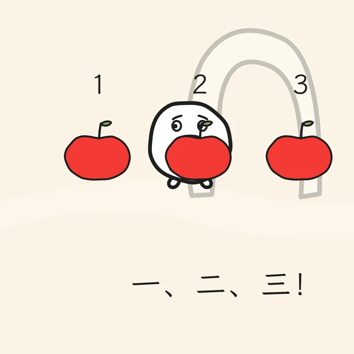

# 《啊呜噜啵！》

> 3–5 岁自己翻自己点的绘本：喂它苹果、小鱼、黄星星，它就变成那个颜色。离线，不注册。

[](LICENSE) [](https://github.com/rockbenben/365opensource)

[⬇ 自己跑一份](#自己跑一份)（`npm install && npm run build`） · [🖨 打印版（64 页）](#打印) · [📖 支持哪些设备](#支持范围)


孩子想自己读绘本，可是不识字、也不会翻页——这本就是给这种孩子的：点一下它就变色，揉一揉它就打嗝喷彩纸，它会躲起来要你找，你喊它一声它就蹦出来说「我看见你啦」。

现在有两册：《啊呜噜啵！》孩子喂它；《噜啵生病啦！》它病了，换孩子照顾它——盖毯子、喂水喂药、半夜守着它睡。

## 支持范围

| 方面 | 说明 |
|---|---|
| **屏幕** | 任何现代浏览器（Chrome / Safari / Edge / Firefox）。手机与平板要用 http(s) 打开——`file://` 下音频与字体被浏览器限制（iPad 尤其明显），实测 http 下一切正常。 |
| **打印** | 成品 210 × 210 mm（PDF 216 × 216 mm 含 3 mm 出血），骑马钉；A4 双面拼版对折即成，另有 A3 版。页数是 4 的倍数，排得开帖。 |
| **离线** | 全部离线可用。页面不请求任何外部资源（闸门里有这一条）。 |
| **构成** | 文字、声音、互动、字体全在一个 HTML 文件里，不依赖位图插画——改一句话就能重印一版。 |
| **字体** | 内嵌子集，可商用（OFL 1.1），详见 [LICENSES.md](LICENSES.md)。 |
| **参考书** | 只用于画风分析，不随项目分发；角色、咒语、桥段、构图全部原创。 |

## 能做什么

- **喂它**：喂红苹果、蓝小鱼、黄星星，它就变成那个颜色；三样一起吃会变彩虹。
- **揉它**：揉肚子、转圈，打嗝会把彩纸喷满整页。
- **找它**：跟它躲猫猫、数一数有几个苹果，它会从草丛里蹦出来说"我看见你啦"。
- **一起玩**：拍手、转圈、跺脚，孩子动起来，大人也跟着动。
- **读给孩子听**：每一册 64 页、28 个跨页，每页只做一件事；旁白念给孩子，拟声词让孩子跟着说。

## 怎么用

给孩子读：**指着画里的东西念出来**——「苹果！」「小鱼！」「星星！」。孩子点一下，噜啵就吃下去、变成那个颜色；拟声词（啊呜、嗝、呼噜、咕噜）念给它听，它会回应。

翻页：点书页空白处，或左右滑动，或用方向键。**不必按顺序读**——右上角的页码按钮能直接跳到任何一页，想找「数一数」那页不用从头翻。

屏幕够宽时是**摊开的两页**，像真的翻开一本书：左右两页并排，翻一次翻一跨（和纸书的骑马钉装订一样）。屏幕窄了就回到一页一屏——手机上两页挤在一起字太小。

右上角的 ☰ 按钮里有两件事：**选一册**与**看它的方式**（网页 / 打印版 / 骑马钉拼版）。

一册 = 一本书 = 64 页。现在有两册：**《啊呜噜啵！》**——孩子喂它，它就变成那个颜色；**《噜啵生病啦！》**——它病了，这次换孩子照顾它（盖毯子、喂水、喂药，半夜守着它睡）。

大人读：**旁白念给孩子听，拟声词让孩子跟着说**。点错了不用说「不对」，再来一次就好。

## 看看长什么样

屏幕够宽时摊开成两页，像真的翻开一本书——左边是刚读过的那页，右边是还没读的那页：


| 找一找 | 数一数 |
| --- | --- |
|  |  |

| 它看见你啦 | 都是你的 |
| --- | --- |
|  |  |

<sub>截图由 `npm run shots:readme` 从当前构建自动生成，页面一改就重跑一次。</sub>

## 限制

- **界面全中文**：没有英文版。纸书版也没有声音——声音是屏幕版用 Web Audio 现场合成的。
- **还没有在线试玩**：这一版还没发布到网上。克隆下来跑一次就能看（`npm install && npm run build`，然后双击 `dist/index.html`）——绘本是一个单文件，拷到哪台电脑都能开。
- **手机与平板要用 http(s) 打开**：`file://` 下浏览器会限制音频与字体（iPad 尤其明显）。
- **还没有实物打样**：PDF 的版式检查、逐页 300 dpi 检查都过了，但还没在纸上印过一遍。
- **参考书不随项目分发**：画风分析用的 PDF 要自己准备（版权原因）。

## 给开发者

### 自己跑一份

```bash
npm install && npm run build     # → dist/index.html（单文件，双击就能看）
```

改一句正文就重印一版：

```bash
npm run fonts    # 按全书实际用字切字体子集——改了正文文字必须先跑这个
npm run build
npm run pdf      # → dist/<册>.pdf（216 mm 单页，每册一本，交给印厂）
```

全部命令见 [命令](#命令)。

### 当前进度

| 阶段 | 内容 | 状态 |
|---|---|---|
| M0 风格样张 | 骨架、令牌、角色零件与姿态、笔触特效层、授权核验 | ✅ 完成 |
| M1 全部页面 | **两册各 64 页全部落地**、每册 28 个跨页、12 套模板、26 种互动 | ✅ 完成 |
| M2 互动 | 彩纸飞行动画、找一找反馈、减少动效、设备测试 | 部分（基础反馈已有） |
| M3 印刷 | PDF 管线已通（64 页 / 216 mm / 字体内嵌）+ A4/A3 骑马钉拼版；布局检查、300 dpi 逐页检查、实物打样 | 部分 |
| M4 共读测试 | **「幼儿乱读」自动化压力测试已落地**（`npm run chaos`）；真人试读 | 部分（自动化已覆盖，待真人试读） |

### 命令

```bash
npm install          # 依赖：vite、vite-plugin-singlefile、playwright、两个字体包
npm run fonts        # 按全书实际用字切字体子集（src/fonts/*.woff2）——**改了正文文字必须先跑这个**
npm run fx           # 重新生成笔触特效 + 几何表（改了 gen-effects.py 才需要跑）
npm run build        # vite build → dist/index.html、print.html、proof.html、booklet.html
npm run dev          # 开发服务器（改页面数据即时刷新）
npm run check        # 页面数据检查（64/60 页强校验 + 页数必须是 4 的倍数）+ 内容审查（页号连续、trap 页能过、多步互动凑得齐、热区不打架）+ 热区检查（每个热区都罩住它指的东西的**墨迹**、320px 小屏上不小于 44 CSS px）+ 版式检查（屏幕版与印刷版各量一遍；含热点是否罩住道具与角色、角色与道具有没有被页面边缘切掉）+ 字体授权闸门 + 字体覆盖检查
npm run shots        # 逐页截图（Playwright 自己拍，1440 × 1440）
npm run shots:readme # README 的门面图（首屏横幅 + 图库 + 摊开的两页）→ docs/images/*.webp
npm run check:shots  # 截图闸门：每页都得真的画出来，且背景要铺满四条边
npm run check:contrast # 文字对比度闸门：按真实像素量文字底下是什么颜色（正文 ≥ 4.5:1，大字 ≥ 3:1）；屏幕版与印刷版都量
npm run smoke        # 交互冒烟（Playwright，114 项断言，含"每个音色都得有声"、"选页器能跳页"、"外壳能选册切模式"、"宽屏摊成跨页"、"跨页里左页的互动不带走右页"）
npm run chaos        # 幼儿乱读压力测试（Playwright，随机种子可复现）
npm run pdf          # 导出 dist/<册>.pdf（216 mm 单页，每册一本，交给印厂）
npm run pdf:booklet  # 导出 dist/<册>-a4-duplex.pdf（A4 双面拼版，对折即成书；加 --a3 出 A3 版）
npm run og           # 生成社交预览图 dist/og.png（1280 × 640，上传到 GitHub Settings → Social preview）
```

> **`npm run check` 查不出"图坏了"**：它量的是版式与结构，不是像素。曾经有一次把"书页居中"的 CSS 写成了 `body.screen`，拼版（`body.screen.static`）也吃到了这条规则，32 页全叠到一起——结构 / 版式 / 冒烟 / 压力测试**全部通过**，只有人眼看联系表才发现整本白板。所以出图之后要跟两步：`npm run check:shots`（每页墨迹占比不能低于 1%，且声明了满版底色场的页，四条边的主色不能还是纸白）与 `npm run check:contrast`（文字压到什么颜色上，就得跟它对比度够）。这两步现在都在 CI 里跑（截图与对比度都由项目自己用 Playwright 拍）。

**工具链**（都是成熟依赖，不自造轮子）：

| 环节 | 用什么 |
|---|---|
| 打包 / 压缩 / 内联 / 开发服务器 | **Vite** + **vite-plugin-singlefile**（产出单文件 HTML） |
| 页面模板 | **Handlebars**（`src/templates/page.hbs`，模板里不写逻辑） |
| 背景满版与笔触摆位 / 拟声词逐字微转 | `tools/render-page.mjs`（本书特有的画法规则，没有现成库） |
| 字体子集 | **fontTools**（`pyftsubset`） |
| 字体覆盖检查 | **fontTools**（读 cmap） |
| 印刷 PDF | **Playwright**（Chromium 打印） |
| 逐页截图 | **Playwright**（Chromium 元素截图） |
| 交互冒烟 | **Playwright** |

> 页面框架的自研部分只剩两件事：**背景的满版底色与笔触摆位**和**拟声词逐字微转**—— 前者保证背景铺满整页（含出血），后者让每个字歪一点点。两者算完交给 Handlebars 模板，模板本身不含逻辑，改版式只改模板或数据。

> `npm run check` 里的 **字体授权闸门** 会逐个核对字体包的 LICENSE：不在白名单（OFL 1.1 / OFL 1.0 / Apache-2.0 / MIT）、出现"仅供个人使用/非商用"表述、或声明了保留字体名的字体，都会让检查失败。换字体后必须重跑。

### 目录

```
src/
  content/
    book.json          # 书名与副标题（页面清单在 specs/ 里）
    books/
      index.js          # 册清单（一册 = 一本书 = 64 页；加一册 = 建目录 + 加一行）
      awulubo/         # 第 1 册《啊呜噜啵！》——孩子喂它
        book.json      # 该册的书名与副标题
        specs/*.js     # 页面数据：每页的背景/角色/道具/文字/热点（框架的输入）
                       #  30 个文件，01-front…61-back 按书的顺序编号，一个文件对应一个跨页
      labuluo/        # 第 2 册《噜啵生病啦！》——孩子照顾它
        book.json
        specs/*.js     # 同样是 30 个文件
  components/
    character.svg      # 噜啵的零件与姿态（9 个基本姿态 + 12 个情绪姿态：curious/shy/surprise/cheeky/cheer/wave/sleepy/tired/proud/yawn/ouch/grumpy）
    props.svg          # 苹果 / 小鱼 / 星星 / 白底块 / 月亮 / 圆箭头 / 气泡 / 小花 / 毯子 / 水杯 / 药丸 / zzz
    effects.svg        # 笔触特效层（满版底色场/放射线/色带/漩涡/色盘/彩纸/彩虹条/星星）
    effects.json       # 每种特效的几何（圆心/半径），与图形同源，渲染器据此算放大倍数
    rainbow.svg        # 彩虹身体的六条色带
  css/
    tokens.css         # 色板、字阶、角色颜色状态
    fonts.css          # 字体子集的 @font-face（Vite 负责内联）
    book.css           # 舞台、可点目标、动画、打印规则
    booklet.css        # A4 拼版专用（自己的 @page 纸张尺寸与格子）
    templates.css      # 模板底色 + 文字默认样式（位置与字号由页面数据给）
  js/
    boot.js            # 入口：按顺序引入下面五个
    audio.js           # Web Audio 合成音效（25 个音色）
    interactions.js    # 热点 → 反馈 → 翻页
    book.js            # 翻页状态机、导航、朗读播报
    picker.js          # 选页器：缩略图网格，直接跳到任意一页
    shell.js           # 外壳：选册 + 换显示方式（网页 / 打印版 / 骑马钉拼版）
  fonts/               # 字体子集（woff2，构建产物；**提交进仓库**，clone 后不必装 Python 也能构建）
public/
  edgeone.json         # 随产物走的 EdgeOne 配置（只管缓存与安全响应头）
.github/workflows/
  ci.yml               # 推 main / 提 PR：全套闸门
  deploy.yml           # 推 main：构建产物推到 gh-pages 分支，EdgeOne 从那里取
deploy/                # 部署速查 + nginx / Caddy / Docker / 一条命令等现成配置
requirements.txt       # Python 侧依赖（只有字体那两步要）
index.html             # 屏幕版入口
print.html             # 印刷版入口
proof.html             # 拼版入口（供截图）
booklet.html           # A4 双面拼版入口
vite.config.js         # 四个入口 + 单文件输出
tools/
  render-page.mjs      # 页面数据 → HTML（含背景满版与笔触摆位、拟声词逐字微转）
  load-specs.mjs       # 读取全部页面数据
  layout-constants.mjs # 页宽/边距/页数等共用常量
  vite-pages.mjs       # Vite 插件：注入页面与 SVG 组件
  build-fonts.mjs      # 字体子集
  check-pages.mjs      # 页面数据检查（--full 强校验 64/60 页 + 页数是 4 的倍数）
  audit-content.mjs    # 内容审查（页号连续 / trap 页能过 / 多步互动凑得齐 / 热区不打架）
  verify-audit-teeth.sh # 给上一条闸门验牙齿：故意弄坏一处，确认它报错
  check-hotspots.mjs  # 热区检查（热区要罩住目标的墨迹 + 320px 小屏上不小于 44 CSS px）
  check-layout.mjs     # 版式检查（Playwright 量墨迹：重叠 / 越界 / 裁切 / 热点是否罩住道具）
  check-licenses.mjs   # 字体授权闸门
  check-text.py        # 字体覆盖检查（漏字会退回系统字体）
  check-shots.py       # 截图闸门（每页有内容 + 背景铺满四条边）
  check-contrast.mjs   # 文字对比度闸门（按真实像素量底色）
  dump-text.mjs        # 逐页导出全书文字与字数
  gen-paths.py         # 手绘路径生成器（身体、螺旋、苹果、星星、白底块）
  gen-effects.py       # 笔触特效生成器（满版底色场、射线、色带、漩涡、色盘、彩纸、彩虹）+ 几何表
  smoke.mjs            # 交互冒烟
  chaos.mjs            # 幼儿乱读压力测试（乱点/连点/乱翻/乱划/乱敲键盘）
  pdf.mjs              # 导出印刷 PDF（单页，216 mm）
  pdf-booklet.mjs      # 导出 A4/A3 双面骑马钉拼版 PDF（家用打印用）
  shots.mjs            # 逐页截图（Playwright 自己拍）
  readme-shots.mjs     # README 门面图的素材（首屏横幅四格 + 图库 + 摊开的两页）
  readme-compose.py    # 素材 PNG → docs/images/*.webp（拼版与转码）
  shot-one.mjs         # 重截单页（调版式时用）
  shot-fx.mjs          # 单独渲染一个笔触特效（查笔触本身的问题时用）
  contact_sheet.py     # 联系表
dist/
  index.html           # 屏幕互动版（单文件，离线双击可读，每册 60 页，共 120 页）
  print.html           # 印刷版（单文件，216 × 216 mm 出血页，每册一本 64 页）
  booklet.html         # A4 双面拼版入口（每面并排两个书页，对折即成书）
  proof.html           # 拼版（全部页面平铺，供截图）
  <册>.pdf             # 印刷 PDF（每册一本）
  shots/               # 逐页 1440 × 1440 截图 + 联系表 + manifest.json（每册一个子目录）
deploy/                # 部署用的现成配置（nginx / Caddy / Docker / 一条命令）
```

### 页面框架：改版式只改框架，不改 30 份文件

每页是一份**数据**（`src/content/books/<册>/specs/*.js`），不是一份手写 HTML：

```js
{
  id: 'p04',
  template: 't-dialog',
  sound: 'gulu',                       // 音效名
  aria: '咕噜，咕噜。谁的肚子在叫？',
  bg: { kind: 'bands', colors: ['--yellow', '--yellow-deep'], focus: [500, 500], wash: '--wash-yellow' },
  char: { pose: 'hungry', at: [190, 200], scale: 0.62, spiral: true },
  props: [{ kind: 'apple', at: [320, 180], scale: 0.36 }],
  text: {
    sound: { at: [40, 30], size: 11, rotate: -2 },
    narration: { at: [50, 160], size: 3.4, width: 340 },
  },
  hotspot: { action: 'belly', at: [366, 488], size: 260, label: '点一下噜啵的肚子' },
}
```

- **坐标单位是页宽千分比**（0–1000），跟画布的 viewBox 一致。
- **背景是两层：满版底色场 + 笔触。**
  - 底色场（`bg.wash`）铺满整页含出血——色块长在页面上，不是浮在白纸上的孤岛。它的半径大于页面对角线的一半，所以"铺满"是几何保证，不靠逐页手调放大倍数。
  - 笔触按各特效**自己的几何**摆位：放大倍数由「焦点到页面最远角的距离 ÷ 特效半径」算出，笔触永远冲出画外。`cover: 'x' | 'y' | 'all' | 'none'` 可控方向。
  - 每种特效的圆心与半径来自 `src/components/effects.json`，与图形同源生成（以前两边各抄一份半径表，改了图形忘了改表，背景就盖不满）。
- **热点可以给一个或一组**（p14 的三样、p30 的三个道具各是三个热点）。
- 页面清单只有这一份来源：构建、检查、字体子集、截图都从 `specs/` 读。

### 几条实现上的关键约定

1. **组件一律用 `<g>`，不用 `<symbol>`。** `<use>` 引用 `<symbol>` 会建立一个视口，超出部分被裁掉——出血的笔触会被切出一条笔直的边（2026-10-30 踩过：p09 放射线被横切、p05 漩涡被竖切）。`<g>` 没有视口，`<use>` 只克隆不裁剪；摆放一律 `transform="translate() scale()"`。

2. **零件被 `<use>` 引用后落在影子树里，文档 CSS 选择器不生效。** 所以 `components/*.svg` 里所有外观都写成元素内联样式，颜色与线宽走 CSS 变量（自定义属性能穿透影子树）。角色的颜色状态 `.state-red` 挂在页面的 `<g class="char">` 上，变量一路继承进零件。

3. **螺旋单独引用。** `pose-*` 里不含螺旋，页面额外写一行 `<use href="#ch-spiral" class="spiral">`，这样文档 CSS 才转得到它（屏幕上慢转，印刷与"减少动效"时不动）。

4. **拟声词逐字微转在构建时完成。** `tools/render-page.mjs` 把 `<h1 class="sound">` 里的每个字包成 `<span style="--r:…deg;--dy:…%">`，角度 ±3°、位移 ±1%，由字序确定性生成。打印与屏幕共用同一份标记。

5. **满版色页上角色与底色同色。** 角色身体用页面色，靠粗黑线与白色细节（眼白、瞳孔、舌头）撑住形状——这是参考书同款做法。

6. **出图用 Playwright 自己拍。** `dist/proof.html` 里的页面固定 720 × 720 CSS px，2 倍拍出 1440 × 1440。产物内联了全部 CSS/JS/SVG/字体，不应有任何外部请求。
   > 以前这一步靠本机的 html-shot 技能（路径写死在脚本里）：换台机器跑不了、CI 里更跑不了，"每页都得真的画出来"这道闸门就只能在某一台机器上守着。现在截图与对比度都由项目自己用 Playwright 拍，CI 上跑得动。

7. **同一时刻最多只有一个待定效果，且它一定属于读者当前所在页。** 换页（`show()`）会作废还在计时的效果；计时器到期时再校验一次当前页，对不上就丢弃。不守这条不变量的后果是实打实的：上一页的"翻页"会活到读者翻走之后，等他回头再进那一页，页面会莫名自己翻走。

8. **进页面要复位这一页"已经演出过的效果"。** 读者会走回头路（p28 摸噜啵、p62 再读一次都跳回 p04）。`BookInteractions.reset(page)` 不只清计数，还要复位页面状态类（`is-dim` / `is-bloom`）、揉肚子的螺旋角度、以及"越吃越圆"的角色缩放—— 不复位的话，读者第二次进 p26 会发现灯还是暗的、点月亮没反应。

9. **页面的键一律用 `data-id` 字符串。** `Book.after()` / `Book.skipPending()` 内部用 `pageKey()` 归一化，元素和 id 都收，但类型不认识会直接抛错——传错时早失败早好，静默合并成一个键会让所有页面的计时器互相打架。

10. **节流只限速，不吞输入。** 翻页最短 350 ms 一页（防止一帧跳两页），但锁住期间到达的翻页请求会被**记住**，锁一开就补上：每个 350 ms 窗口里只要有点击就翻一页。以前是"锁住就丢"——孩子连点六下只有两下有反应，另外四下"点了没反应"，听起来就是坏的。实测（150 ms 间隔连点 6 下）：修前前进 2 页，修后 4 页。排队中的请求也会被**换页作废**（`show()` 里清），否则它会在新页面上突然翻一页。

11. **多步互动的页面标 `trap: true`：点空白不翻页。** "按顺序点三样 / 再喂一口 / 揉肚子 / 找一找"这几页要点好几下才过，点错地方就翻页等于把这一页跳过去——"找一找"更糟，会直接跳到"你都找到了吗？"，孩子一个都没找到。标了 `trap` 的页面，点空白（**书页内外都算**）只摇一下头；连错 5 下才放人走。
    > 摊成跨页时这道闸门按**整组**算：点旁边那一页的空白也不行，否则孩子能靠点旁边那页把要互动的一页跳过去。但**往回走不受它拦**——回去不算跳过这一页，孩子还会回来。唯独点在**正在等动作的那一页**上时不往回走：那是点空了，该摇一下头；往回走反而把孩子带离任务，前面攒的进度也会被清掉。

12. **热区必须罩住道具本身。** 道具是按组件自己的几何渲染的，页面里写的 `at` 是锚点，不等于它在页面上的位置。热区没罩住的话，"点一下那条鱼"点不到鱼——书直接翻页过去。`tools/check-layout.mjs` 现在会量这件事。

13. **纸上点不动的提示，印刷版要改写。** 页面文案可以带 `print` 字段覆盖印刷版：空字符串 = 印刷版不出现这句（封面"点我，开始。"），也可以换成"翻回第一页吧。"这种纸上做得出来的说法。印刷版的字也要进字体子集（`textsOfAll`）。

14. **手写手势不能挂在 click 上。** 触屏上拖动**不产生 click**，而且浏览器会用 `touch-action: manipulation` 抢走拖动手势、发 `pointercancel`——挂在 click 上的判定在平板/手机上等于没有。所以：判定放在 `pointerup`；该热区 `touch-action: none`；`pointerup/pointercancel` 挂到 document 上统一收尾（手势在热区外结束也要清状态，不然鼠标只是在肚子上晃也会累加角度）。

15. **背景是「满版底色场 + 笔触」两层，底色场是几何保证。** 以前只靠"把笔触放大到最远角"，可笔触有的是环（漩涡）、有的是散点（彩纸）、有的是从页外角冲进来的爆发（角落爆闪）——按圆盘假设去算，16 页的背景是**浮在白纸上的孤岛**，不是满版。现在底色场（`fx-wash`）铺满整页含出血（半径 > 页面对角线的一半），笔触画在它上面；每页必须在数据里声明 `bg.wash`（底色场的颜色），`check-pages.mjs` 会拦下漏声明的页，`check-shots.py` 会量每条边的主色是不是它。

16. **文字压在什么颜色上，就得跟那个颜色对比度够。** 满版底色场一铺开，"黑字 + 深色笔触"这种原来被白纸托着的组合就露馅了（p12 的提示字压在深紫笔触上只有 2.2:1）。`npm run check:contrast` 按**真实像素**量文字底下的颜色（不是页面底色——p9 的旁白其实落在白色气泡上），正文 ≥ 4.5:1、大字 ≥ 3:1。改完底色场要重跑这道闸门。

17. **改了正文文字，先 `npm run fonts`，再构建。** 子集漏字时浏览器会拿系统字体顶上（STKaiti/SimSun…），**那些字体没有商用授权**。页面上完全看不出来，只有把 PDF 的字体清单拉出来才知道—— 真实发生过：改完编者说没重切子集，印刷 PDF 里就多了一套 STKaiti。现在两道闸门拦着：`npm run check` 会查子集是不是最新（`build-fonts.mjs --check`），`npm run pdf` 会查 PDF 里除了自己那两套子集还有没有别的字体。

18. **点角色要有反应，而且不靠逐页摆热区。** 孩子最先戳的就是它。规则是"点看得见的东西它有反应，点空白才翻页"—— 点到角色（`event.target.closest('.char')`）就晃一下、叫一声，然后这一组好了才翻。不逐页摆热区是因为热区要靠猜角色的可见框（锚点 ≠ 可见中心），而事件目标直接告诉我们点在谁身上。`trap` 页除外：那些页在等一个特定动作，点哪儿都不该翻过去。

19. **拼版的纸张尺寸要用具名页面隔开。** 四个入口共用一份 CSS（vite 的 `cssCodeSplit: false`），裸 `@page { size: … }` 会把印刷版也改成 A4 横排——印刷 PDF 直接变成 72 页。所以拼版用 `@page booklet` + `page: booklet`，只有拼版的 `.sheet` 用它；`npm run pdf` 会查 PDF 页面是不是 612×612 pt。

20. **音色接错节点不会报错，只是没声音。** `AudioBook.play` 原来把异常整个吞掉（音频出错也不该挡住翻页，这没错），但音色写错了就永远没人知道——页面上只是"没声音"。现在异常会 `console.warn`，并且 `AudioBook.probe(name)` 能量出这个音色的峰值，`npm run smoke` 逐个音色量一遍：静音的音色一律判失败。

21. **每样东西有自己的声音。** 孩子点的是那个东西，响的就该是那个东西的声音：苹果咔嚓、小鱼哗啦、星星叮一声。统一的"啊呜"只留给噜啵自己（页面拟声词）。绘本常用的场景声音（翻页沙沙、拍手、铃铛、笑声、风、叹气、动物叫）也在库里，见设计规格 §14.6。

22. **角色的位置写在 SVG 的 transform 属性上，CSS 的 transform 会把它顶掉。** 道具动画用 CSS 的 `translate` 而不是 `transform`（数一数那页的苹果就是这么做的），角色也一样。飞、转圈、跺脚都是逐帧改**属性本身**：`translate(x,y) scale(s) rotate(deg, cx, cy)`——`rotate` 的后两个参数是旋转中心，必须用角色自己的中心（`getBBox()` 量），绕页面原点转会把角色甩到角落里。回头再进这一页要复位：渲染器把原始位置写在 `data-base-transform` 上。

23. **版式闸门以前只查道具热区，角色热区没人管。** p28「摸摸噜啵」的热区压在角色上方空处——点它的脸点不到，而闸门全绿。现在补了三条：角色的热区必须罩住角色中心；角色不能被页面**左右**边缘裁掉（p53 的角色被切出一条竖直直边，像被门夹了一下）；上下出血不算错——"喂东西"那三页是特写，角色大到出画，读起来是"凑得很近"。
    > 新闸门要有牙齿才算闸门：写完先**故意把热区挪歪**，确认它报错，再改回去。

24. **"静态亮着"的东西不能被复位逻辑清掉。** p40 的答案「3」是页面数据里写死亮着的（`numbers[].on = true`），它不是读者数出来的，是本来就在那儿。`BookInteractions.reset()` 以前把这一页所有 `is-on` 的数字都清掉，结果读者数完三个苹果翻到答案页，上面写着"三个红苹果！"，那个大大的「3」却不见了——答案页没了答案。现在只有**真的带数数热区**的页才复位数字。

25. **揉肚子的手势，鼠标跟触屏要一样。** 触屏天生有隐式指针捕获，鼠标没有：指针滑出肚子上那个热区，`pointermove` 就不再来了——圈画到一半"断了"，螺旋是跳着转的，断掉的那几段角度还被当成一次大跳转补上，"画满一圈"就成了假账。所以按下时用 `setPointerCapture` 把指针抓在热区上。另外，"点一下"和"画了一笔"要分得清：量的是**离按下点的位移** （超过 14 px 才算画），不是角度抖动—— 手指按下时抖 1° 也算"画了"，那一按就什么反应都没有，孩子看着像坏了。

26. **带 #pXX 打开，进场音效只响一遍。** `start()` 里以前是 `show(k)` 之后又 `show(current)`—— 地址栏带页号打开时这一页的音效会同时响两遍，页面状态也被复位两次。现在先算出起始页，只调一次 `show()`。

27. **只用键盘读书的孩子也得有声音。** 音频上下文原来只在第一次 `pointerdown` 时解锁—— 键盘用户不点屏幕，上下文就一直挂着，整本书没有声音。现在第一次 `keydown` 也解锁。

28. **闸门要量读者真正拿到的那一份。** `dist/proof.html` 走的是**印刷口径**：64 页，印刷版文案；`dist/index.html` 走**屏幕口径**：60 页，屏幕版文案（"点我，开始。"这类纸上点不动的提示，纸上要改写）。两份文案不一样，版式自然也不一样。以前只量印刷口径，于是屏幕版要是有一句字压到了别的东西上，全套闸门照样全绿——而屏幕版才是孩子手里那一本。现在版式检查与对比度检查都过这两份产物。

29. **背景要按每种特效自己的圆心摆位。** `effects.json` 里记着每种特效的圆心与半径，圆心大多在 (500,500)，但 `rays-corner` 不在——它的圆心在 (-40,1040)，页外的左下角，"从角落冲上来"就是这么生成的。渲染器以前一律按 (500,500) 摆：focus 挪的是符号的局部原点，不是它的圆心。于是 p52 的放射线被整体推下去 400 单位，"从脚底冲上来"变成了"从左下角斜着抹过"。现在按各特效自己的圆心摆；角落爆发那几页把 focus 写成它的圆心，画面与以前一模一样。

30. **闸门不能"什么都没量"还说通过。** 字体覆盖检查读不到页面文字时，以前会打印一句"✗ 读取失败"，然后又打印"✓ 字体覆盖检查通过：全书 0 个字符"，退出码 0—— 它拦的正是"漏字退回未授权的系统字体"，却在失效时报绿。对比度检查同理：截图不在，一个字都没量，也报"全部达标"。现在这两道闸门量不到东西就退出码 1。

31. **CI 要能在一台干净的机器上跑通。** `dist/` 不进仓库，版式检查量的是 `dist/proof.html`—— 所以**必须先构建再检查**，否则干净检出上必然报"找不到 dist/proof.html"，流水线永远是红的。字体子集的戳记（`src/fonts/.*.stamp`）也必须进仓库：它记的是字符集与源字体的**哈希**（跟机器无关），戳记不进仓库，干净检出上就没有"子集是最新的"这个凭据。

32. **页面数据要过一遍"内容审查"。** `tools/audit-content.mjs` 查的是"读代码看不出来、读数据也容易看漏"的那几类错：页号跳号、trap 页没有热区（孩子卡死在那页）、热区的 target 在运行时解析不出来（道具改了名却忘了改 class，点下去静默不反应）、多步互动页凑不齐（find 少一个目标、feed3 少一样、count 的 index 跳号或道具不够）、文字点名的物件没有热区罩住、同页热区互相压住、热区小于 25% 页宽。
    > 这道闸门也有 11 条"牙齿"验证脚本（`tools/verify-audit-teeth.sh`）：故意弄坏一处 → 必须报错 → 改回去。写新闸门时照这个流程走。

33. **孩子照着"看得见的东西"点，热区必须罩住那东西的墨迹。** `tools/check-hotspots.mjs` 量的是**墨迹**外框，不是元素外框—— 星星的四个角、圆弧之间的空隙都是外框里的空白，按外框判会放过"热区罩着一大片空白、真正的墨在框外"的情况。以前只量"目标的中心在不在热区里"，边缘留出一大片死区它看不见：p62 那个手绘圆圈有 42% 的墨在热区外——那是全书最后一页唯一的按钮，孩子瞄准圆圈左边按下去，书只是摇一下头。同一道闸门还量**小屏上的实际大小**：320px 的屏上不小于 44 CSS px （平台最小可点目标）。规格 §7.6 写的"120 × 120 CSS px"是在多宽的屏上算的，规格里没写；一页上摆三个目标（找一找）时，320px 的屏塞不下三个 120px，所以兜底用平台那条线。

34. **"转个圈"要围着画出来的那个东西转。** 提示写"在肚子上画个圈"，孩子描的自然就是屏幕上那个螺旋。p20 的旋转中心原来取**热区**中心，而热区罩的是整块肚子，中心落在螺旋上方 88 个单位处：手指绕的是螺旋，量的却是另一个点，角度正负相消，净累计 0°——螺旋一格也不转，这一关永远过不去。现在旋转中心取螺旋自己的中心（`getBBox` 量它没转时的几何，再按角色的矩阵换算到屏幕坐标），热区也挪到螺旋上。
    > 这条有冒烟测试守着：照着画出来的螺旋描一圈，必须转够 300° 并翻页。把修复拆掉，这条断言就报"累计 0°"。

35. **要点好几下才过的页，要标 trap。** p42「喊三声它才听见」以前没标 trap：它的整页热区只罩住**书页**，书页之外的留白（手机上竖屏时书只占中间，上下都是空的）点下去就成了翻页——孩子一次也没喊，"它听见了"那一拍整段错过。其他要点好几下的页（p14/p16/p20/p30/p38）一直都标着，就它漏了。
    > 也有冒烟测试守着：竖屏下点书外留白，不能翻页。

36. **圆的东西被页边切一刀，就是印刷出错。** p26 的月亮是个圆，右缘伸到 1036、超出 36 个单位，被页边切出一条笔直的竖边。下一页 p27 用的是同一个月亮，放 [660,120] 就在页内—— 同一本书里两页对不上。角色那边早有"左右出血才算错"的规矩，现在道具也照这条量（上下出血不算错：白底块就是要出画）。

37. **一跨两页，左页的互动不许把右页一起带走。** 摊开成跨页时，一个动作演完**不能**直接翻页—— `Book.next()` 在跨页模式里翻的是**一整跨**，于是 p16|p17 喂饱三口 → 整跨翻到 p18|p19，p17 的「点点它的肚子」永远没机会演；p22|p23 的彩纸演完，p23 的「它飞过去」也没了；p44 拍一拍角色，p45 的「我看见你啦！」同样被顺走。现在动作演完调 `Book.finish(page)`（给这一页写上 `data-done`），整组都好了才翻（`Book.turnIfDone()`）；单页模式下一组就一页，行为跟从前一样。
    > 点空白仍然是「跳过」：没做完也能翻过去——「一页只做一件事」不是「必须做完」，要点好几下的页靠 `trap` 拦。这一轮改的是「动作演完不再顺手翻走」。
    > 这条有冒烟测试守着，而且**跑在宽屏上**：跨页里的互动一条都没量过，所以这个毛病能在闸门全绿的情况下活好几天（前面的断言都跑在 900px 的单页模式上）。把 `turnIfDone` 里那句 `if (groupPending()) return;` 去掉，三条断言立刻变红。

### 出图

```bash
# 逐页（屏幕版 1440 × 1440；印刷版用 --print）
npm run shots

# 联系表
python tools/contact_sheet.py "dist/shots/*/p*.png" -o dist/shots/contact.png --cols 4 --cell 330
```

### 打印

有两份 PDF，用途不同：

| 文件 | 纸张 | 用途 |
|---|---|---|
| `dist/<册>.pdf`（`awulubo.pdf` / `labuluo.pdf`） | 216 × 216 mm 单页，64 页 | 交给印厂（按 210 × 210 裁切） |
| `dist/<册>-a4-duplex.pdf` | A4 横放，每个面并排两页，32 个面 | **自家打印机**：双面打 + 对折即成书 |
| `dist/<册>-a3-duplex.pdf` | A3 横放，成品 210 × 210 mm | 同上，不缩小的版本（`--a3`） |

**一册一本。** `npm run pdf` 按册清单逐册导出，两册就是两个文件——以前只有一册，输出写死成 `book.pdf`；有第二册之后那条命令仍只印一册、还把上一册覆盖掉，「每册一本」就成了只写在清单里、没人兑现的一句话。

**页数 64 = 4 的倍数**：骑马钉对折后是 16 张纸、16 帖，每帖 4 页。页数不是 4 的倍数就排不出完整的帖，书脊那一帖会缺一面—— 所以 `npm run check` 会拦下这种页数。

**双面打印**（自家打印机）：

- 选「**双面打印**」，翻页方式选「**翻转长边**」（竖着翻、像翻书）。方形页面的「长边/短边」由驱动决定，翻错了背面会上下颠倒——先打一张试。
- 拼版 PDF 的页序已经按骑马钉排好：最外一张是封面与封底，往里依次往中间收。印完沿中缝对折、中间订一下，就是一本。
- A4 版成品是 148.5 × 148.5 mm（缩到 69%）；想要 210 mm 的原尺寸，用 A3 版。
- 打印机若不支持自动双面，就印两份：一份正序、一份倒序，手动翻面叠回去。

家用打印机直接打单页 PDF 的话：页面比 A4（210 mm 宽）宽 6 mm，请在打印对话框里选**「适应纸张大小 / Fit to page」**（多数驱动也会自动缩到可打印区），打出来就是裁掉出血后的 210 mm 成品。

### 部署

**它本来就是纯静态的**：没有后端、没有账号、没有统计（这是规格里的非目标），屏幕互动版是一个 **465 KB 的单文件**（CSS、JS、字体子集全部内联），扔进任何能发静态文件的地方就能用。

### EdgeOne Pages（本项目默认目标）

模式跟兄弟项目一样（022-onepage / 025-kuafu / 039-text2handwriting / 046-gdp-map）：

```
main 分支（源码）──CI 验过──▶ gh-pages 分支（构建产物）──▶ EdgeOne Pages 直接取这个分支
```

**EdgeOne 只发布、不构建**，所以它的 Git 集成这样填：分支 = **`gh-pages`**、构建命令 = **留空**、输出目录 = `/`。

**缓存与安全响应头**由产物里的 `edgeone.json` 决定（`public/edgeone.json` → 进 `dist/` → 随分支走）：

```json
{
  "name": "awulubo",
  "headers": [
    { "source": "**/*.html", "headers": [{ "key": "Cache-Control", "value": "no-store" }] },
    { "source": "**/*.pdf",  "headers": [{ "key": "Cache-Control", "value": "public, max-age=604800" }] },
    { "source": "/**", "headers": [
        { "key": "X-Content-Type-Options", "value": "nosniff" },
        { "key": "Referrer-Policy", "value": "strict-origin-when-cross-origin" },
        { "key": "Permissions-Policy", "value": "interest-cohort=(), browsing-topics=()" }
    ] }
  ]
}
```

**两个 workflow**（`.github/workflows/`）：`ci.yml`（推 main / 提 PR 时跑全套闸门）、`deploy.yml`（推 main 时把 `dist/` 推到 gh-pages 分支）。CI 需要 Node 24 + Python（`requirements.txt`：fonttools、brotli，只为字体那两步）+ Playwright chromium。

干净构建的产物只有 5 个文件、合计 1.9 MB：`index.html`（屏幕互动版）、`print.html`、`proof.html`（全部页面平铺）、`booklet.html`（A4 拼版）、`edgeone.json`。`shots/` 与三个 PDF 是本地产物，构建机不生成、也不会被上传 ✓。

详见 [`deploy/README.md`](deploy/README.md)（还有 nginx / Caddy / Docker / 一条命令 / 对象存储五套）。

### 自己的服务器

`dist/` 传到站点根目录：

```nginx
root /var/www/awulubo;        # dist/ 的内容直接放这层
location = /index.html { add_header Cache-Control "no-cache"; }   # 改版后别卡在旧版
location ~ \.pdf$ { default_type application/pdf; }                # 类型要对才能翻页预览
```

**三件要注意的事**：

1. **手机/平板要用 http(s) 打开，别用 `file://`**——`file://` 下音频与字体会被浏览器限制（iPad 尤其明显）。实测 http 下一切正常。
2. **PDF 的 Content-Type 要对**，否则浏览器只会强制下载。
3. **公开 = 公开**：屏幕版公开只是"孩子能读"；印刷 PDF 公开意味着任何人拿到链接都能下载打印成品。

**要传多少**：`dist/` 整个目录是 22 MB，其中 8 MB 是 `shots/`（逐页截图，只是给人看的）。真要上架，传 `index.html` + 三个 PDF 就够了（约 5.1 MB）；截图留给印厂或自己存档。

## 授权

见 [LICENSES.md](LICENSES.md)。音效全部为 Web Audio 合成，无第三方采样；参考 PDF 由用户提供，不随项目分发。

## 关于 365 开源计划

[365 开源计划](https://github.com/rockbenben/365opensource) 的第 **#047** 个项目——一个人 + AI，一年 300+ 个开源项目。

[提交你的需求 →](https://365.aishort.top/) · [Discord](https://discord.gg/PZTQfJ4GjX) · [Telegram](https://t.me/aishort_top)
